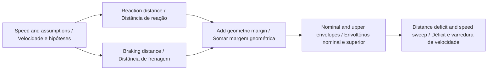
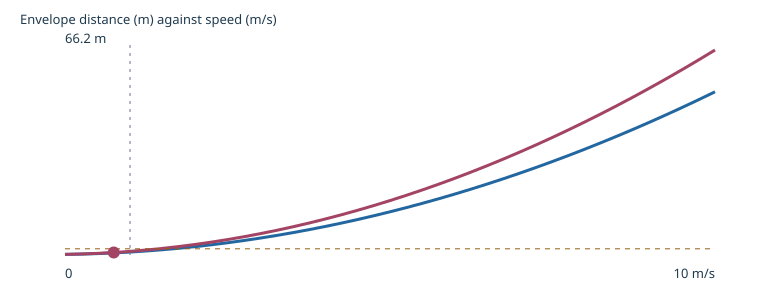
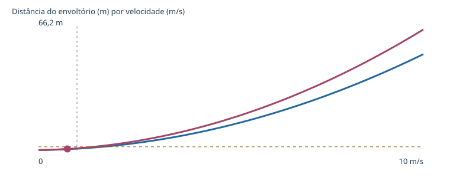

# Go2 PRO Stop Envelope

**Explore stopping-distance assumptions before designing a controlled trial.**  
**Explore hipóteses de distância de parada antes de planejar um ensaio controlado.**

[](https://github.com/galafis/go2-pro-stop-envelope/actions/workflows/ci.yml) · **Working software prototype / Protótipo funcional** · **v0.1.0** · **27 automated tests / testes automatizados** · **MIT**

[English](#english) · [Português](#portugues) · [Live demo · Demonstração](https://galafis.github.io/go2-pro-stop-envelope/) · [Five examples · Cinco exemplos](#examples)

## Workflow · Fluxo de trabalho



<a id="english"></a>

## English

An analytical workbench for a constant-deceleration stopping envelope, explicit reaction delay, uncertainty and geometric margin. It includes a speed sweep and an inverse calculation for the supplied available distance.

### Why this belongs in the Go2 PRO program

A controlled robotics exercise needs explicit assumptions about how much space an observation or stop request consumes. This project teaches the difference between reaction travel, braking travel and additional margin. Its Go2 PRO connection is the design of future measured trials, not a claim about the robot's braking behavior.

### Implemented behavior

- Convert reaction delay from milliseconds to seconds before multiplying by speed. Nominal braking travel assumes constant positive deceleration until zero speed.
- The upper scenario adds reactionUncertaintyMs and reduces deceleration by decelerationUncertaintyPct. These are deterministic bounds chosen by the user, not statistical confidence intervals.
- Add marginM even at zero speed. Preserve a negative available-distance margin rather than clipping an unfavorable result to zero.
- Solve the positive quadratic root for the speed bound with a rationalized expression to avoid cancellation at small distances. A nonpositive usable distance yields zero.
- Generate 41 sweep points from 0 to 10 m/s. The review cursor explores these points without changing the scenario's selected speed.



### Run a complete experiment

Use **Node.js 22 or newer**. The application has no third-party runtime dependencies and does not require an account, API key or connected robot.

```sh
git clone https://github.com/galafis/go2-pro-stop-envelope.git
cd go2-pro-stop-envelope
npm test
npm run examples
npm start
```

Open **http://127.0.0.1:4173**. Select one of the five examples, change **Initial speed (m/s)**, and choose **Update**. Expand the JSON editor to edit the complete scenario. Inspect the chart, review cursor, findings and full-record preview. Export the scenario and report together; only the language preference is stored automatically.

The browser demo and command line use the same `run(scenario)` domain function:

```sh
node scripts/analyze.mjs examples/nominal.json report.json
npm run test:coverage
```

Exit codes are **0** for a completed analysis or review notes, **2** for a valid report requiring review, and **1** for invalid input. Code 2 still writes the report. Imported files are limited to 1 MB; malformed data does not replace the last valid browser result.

### Reproduce a result by hand

The exact-boundary example uses 2 m/s, 0.5 s reaction delay, 2 m/s² deceleration and a 0.25 m margin. Reaction travel is 1 m, braking travel is 1 m and the envelope totals 2.25 m. Supplying exactly 2.25 m leaves zero modeled margin. Reducing available distance to 1 m preserves a −1.25 m deficit.

```text
distance = speed × reactionSeconds + speed² / (2 × deceleration) + margin
upperReaction = (reactionMs + reactionUncertaintyMs) / 1000
upperDeceleration = decelerationMps2 × (1 - uncertaintyPct / 100)
```

The [worked examples](docs/EXPERIMENTS.md) list actual output metrics for all five scenarios. The [algorithm guide](docs/ARCHITECTURE.md) explains the calculation and event flow; the [data contract](docs/DATA_CONTRACT.md) specifies fields, units, limits and semantic checks.

### Validation and interpretation

Tests check known answers, boundary cases, deterministic behavior and failure handling. They also exercise the command line and bilingual chart generation. [Validation notes](docs/VALIDATION.md) link the test files and explain what they establish. Example reports are committed so a changed algorithm produces a reviewable difference.

The model omits slope, friction changes, gait transitions, actuator dynamics, sensing delays outside the supplied reaction term and moving obstacles. No default value is a measured Go2 PRO stopping specification. A nonnegative margin is a mathematical result under assumptions, not a safety guarantee or operating permission.

### From a prototype to a controlled study

Develop a separate supervised measurement protocol on an empty controlled course. Document how speed, request time, motion onset and final position are measured. Begin with measured observations rather than using this output as a command setting. Compare observed envelopes with both nominal and upper scenarios and retain any exceedances.

The current release is independent of physical hardware. The [Go2 PRO development plan](docs/GO2_PRO_PLAN.md) separates software that works now from interface confirmation and physical measurements. A standard PRO configuration must not be assumed to expose custom development interfaces; confirm the exact supported configuration with Unitree.

Related work: [go2-pro-clearance-bench](https://github.com/galafis/go2-pro-clearance-bench). See [integration notes](docs/INTEGRATION.md) for implemented exchange and remaining boundaries.

<a id="portugues"></a>

## Português

Uma bancada analítica para um envoltório de parada com desaceleração constante, atraso de reação, incerteza e margem geométrica explícitos. Inclui varredura de velocidade e cálculo inverso para a distância disponível fornecida.

### Por que este projeto pertence ao programa com o Go2 PRO

Um exercício controlado de robótica precisa de hipóteses explícitas sobre o espaço consumido por uma observação ou solicitação de parada. O projeto ensina a diferença entre deslocamento durante reação, frenagem e margem adicional. Sua relação com o Go2 PRO é planejar futuros ensaios medidos, sem afirmar o comportamento de frenagem do robô.

### Comportamentos implementados

- Converta atraso de reação de milissegundos para segundos antes de multiplicar pela velocidade. O percurso de frenagem nominal pressupõe desaceleração positiva constante até velocidade zero.
- O cenário superior soma reactionUncertaintyMs e reduz a desaceleração por decelerationUncertaintyPct. São limites determinísticos escolhidos pelo usuário, não intervalos estatísticos de confiança.
- Some marginM mesmo com velocidade zero. Preserve margem negativa de distância disponível, sem truncar um resultado desfavorável em zero.
- Resolva a raiz positiva da equação quadrática para o limite de velocidade com expressão racionalizada, evitando cancelamento em pequenas distâncias. Distância útil não positiva produz zero.
- Gere 41 pontos de varredura entre 0 e 10 m/s. O cursor explora esses pontos sem alterar a velocidade selecionada do cenário.



### Executar um experimento completo

Use **Node.js 22 ou superior**. A aplicação não possui dependências externas em tempo de execução e não exige conta, chave de acesso ou robô conectado.

```sh
git clone https://github.com/galafis/go2-pro-stop-envelope.git
cd go2-pro-stop-envelope
npm test
npm run examples
npm start
```

Abra **http://127.0.0.1:4173**. Selecione um dos cinco exemplos, altere **Velocidade inicial (m/s)** e escolha **Atualizar**. Expanda o editor JSON para editar o cenário completo. Inspecione gráfico, cursor de revisão, achados e prévia dos registros. Exporte cenário e relatório juntos; apenas a preferência de idioma é armazenada automaticamente.

A demonstração no navegador e a linha de comando usam a mesma função de domínio `run(scenario)`:

```sh
node scripts/analyze.mjs examples/nominal.json report.json
npm run test:coverage
```

Os códigos de saída são **0** para análise concluída ou notas de revisão, **2** para relatório válido que exige revisão e **1** para entrada inválida. O código 2 também grava o relatório. Arquivos importados são limitados a 1 MB; dados inválidos não substituem o último resultado válido no navegador.

### Reproduzir um resultado manualmente

O exemplo de limite exato usa 2 m/s, atraso de reação de 0,5 s, desaceleração de 2 m/s² e margem de 0,25 m. O deslocamento na reação é 1 m, a frenagem é 1 m e o envoltório totaliza 2,25 m. Informar exatamente 2,25 m deixa margem zero no modelo. Reduzir a distância disponível para 1 m preserva déficit de −1,25 m.

As fórmulas acima usam as unidades explicitadas no [contrato de dados](docs/DATA_CONTRACT.md). Os [experimentos comentados](docs/EXPERIMENTS.md) mostram métricas reais de saída dos cinco cenários. O [guia de arquitetura](docs/ARCHITECTURE.md) explica o cálculo e o fluxo de eventos.

### Validação e interpretação

Os testes verificam respostas conhecidas, casos de fronteira, comportamento determinístico e tratamento de falhas. Também exercitam a linha de comando e a geração dos gráficos bilíngues. As [notas de validação](docs/VALIDATION.md) apontam os arquivos de teste e explicam o que comprovam. Relatórios de exemplo são versionados para que alterações do algoritmo produzam diferenças revisáveis.

O modelo omite inclinação, mudanças de atrito, transições de marcha, dinâmica dos atuadores, atrasos de sensoriamento fora do termo de reação e obstáculos móveis. Nenhum valor padrão é uma especificação medida de parada do Go2 PRO. Margem não negativa é um resultado matemático sob hipóteses, não garantia de segurança ou permissão operacional.

### Do protótipo ao estudo controlado

Desenvolva um protocolo próprio de medição supervisionada em percurso controlado vazio. Documente como medir velocidade, instante da solicitação, início da resposta e posição final. Use observações medidas, sem transformar a saída em configuração de comando. Compare envoltórios observados com cenários nominal e superior, preservando excedências.

A versão atual funciona independentemente de hardware físico. O [plano de desenvolvimento com o Go2 PRO](docs/GO2_PRO_PLAN.md) separa software funcional de confirmação de interfaces e medições físicas. Não se deve presumir que uma configuração PRO padrão exponha interfaces de desenvolvimento personalizado; confirme a configuração compatível exata com a Unitree.

Trabalho relacionado: [go2-pro-clearance-bench](https://github.com/galafis/go2-pro-clearance-bench). Consulte as [notas de integração](docs/INTEGRATION.md) para trocas implementadas e limites restantes.

<a id="examples"></a>

## Reproducible examples · Exemplos reproduzíveis

| Scenario · Cenário                                  | Input · Entrada                             | Expected report · Relatório esperado                      | Status            |
| --------------------------------------------------- | ------------------------------------------- | --------------------------------------------------------- | ----------------- |
| Baseline assumptions<br>Hipóteses de referência     | [nominal.json](examples/nominal.json)       | [nominal.report.json](examples/nominal.report.json)       | `complete`        |
| Longer response delay<br>Maior atraso de resposta   | [latency.json](examples/latency.json)       | [latency.report.json](examples/latency.report.json)       | `review-required` |
| Distance deficit<br>Déficit de distância            | [deficit.json](examples/deficit.json)       | [deficit.report.json](examples/deficit.report.json)       | `review-required` |
| Zero initial speed<br>Velocidade inicial zero       | [stationary.json](examples/stationary.json) | [stationary.report.json](examples/stationary.report.json) | `complete`        |
| Exact analytical boundary<br>Limite analítico exato | [exact.json](examples/exact.json)           | [exact.report.json](examples/exact.report.json)           | `complete`        |

## Repository guide · Guia do repositório

| File · Arquivo                                 | Purpose · Objetivo                                                                                   |
| ---------------------------------------------- | ---------------------------------------------------------------------------------------------------- |
| [src/engine.js](src/engine.js)                 | Domain implementation / Implementação de domínio                                                     |
| [test/](test/)                                 | Numerical, behavioral and integration checks / Verificações numéricas, de comportamento e integração |
| [docs/ARCHITECTURE.md](docs/ARCHITECTURE.md)   | Algorithms and Mermaid sequence / Algoritmos e sequência Mermaid                                     |
| [docs/DATA_CONTRACT.md](docs/DATA_CONTRACT.md) | Fields, units, validation / Campos, unidades, validação                                              |
| [docs/EXPERIMENTS.md](docs/EXPERIMENTS.md)     | Worked examples / Exemplos comentados                                                                |
| [docs/VALIDATION.md](docs/VALIDATION.md)       | Evidence and test boundaries / Evidências e limites dos testes                                       |
| [docs/GO2_PRO_PLAN.md](docs/GO2_PRO_PLAN.md)   | Platform development stages / Etapas de desenvolvimento com a plataforma                             |
| [CONTRIBUTING.md](CONTRIBUTING.md)             | Reproducible contributions / Contribuições reproduzíveis                                             |
| [SECURITY.md](SECURITY.md)                     | Local data handling / Tratamento local dos dados                                                     |

Maintainer / Responsável: **Gabriel Demetrios Lafis** · [gabrieldemetrioslafis@usp.br](mailto:gabrieldemetrioslafis@usp.br)

Independent public research prototype. No vendor or institutional endorsement is claimed. / Protótipo público independente de pesquisa. Não se afirma endosso do fabricante ou institucional.
