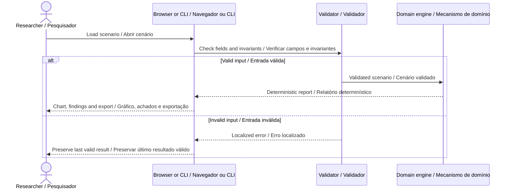

# Architecture · Arquitetura

[README](../README.md) · [Contract / Contrato](DATA_CONTRACT.md)



## English

An analytical workbench for a constant-deceleration stopping envelope, explicit reaction delay, uncertainty and geometric margin. It includes a speed sweep and an inverse calculation for the supplied available distance.

1. Convert reaction delay from milliseconds to seconds before multiplying by speed. Nominal braking travel assumes constant positive deceleration until zero speed.

2. The upper scenario adds reactionUncertaintyMs and reduces deceleration by decelerationUncertaintyPct. These are deterministic bounds chosen by the user, not statistical confidence intervals.

3. Add marginM even at zero speed. Preserve a negative available-distance margin rather than clipping an unfavorable result to zero.

4. Solve the positive quadratic root for the speed bound with a rationalized expression to avoid cancellation at small distances. A nonpositive usable distance yields zero.

5. Generate 41 sweep points from 0 to 10 m/s. The review cursor explores these points without changing the scenario's selected speed.

```text
distance = speed × reactionSeconds + speed² / (2 × deceleration) + margin
upperReaction = (reactionMs + reactionUncertaintyMs) / 1000
upperDeceleration = decelerationMps2 × (1 - uncertaintyPct / 100)
```

The engine receives plain JSON and returns plain data. It has no browser, network or private-core dependency. Validation finishes before computation. Reports preserve the source label and analysis version, omit wall-clock timestamps and can be compared byte-for-byte after formatting. The browser uses a revision counter to prevent an older import from replacing a newer result. Every displayed external string is escaped.

## Português

Uma bancada analítica para um envoltório de parada com desaceleração constante, atraso de reação, incerteza e margem geométrica explícitos. Inclui varredura de velocidade e cálculo inverso para a distância disponível fornecida.

1. Converta atraso de reação de milissegundos para segundos antes de multiplicar pela velocidade. O percurso de frenagem nominal pressupõe desaceleração positiva constante até velocidade zero.

2. O cenário superior soma reactionUncertaintyMs e reduz a desaceleração por decelerationUncertaintyPct. São limites determinísticos escolhidos pelo usuário, não intervalos estatísticos de confiança.

3. Some marginM mesmo com velocidade zero. Preserve margem negativa de distância disponível, sem truncar um resultado desfavorável em zero.

4. Resolva a raiz positiva da equação quadrática para o limite de velocidade com expressão racionalizada, evitando cancelamento em pequenas distâncias. Distância útil não positiva produz zero.

5. Gere 41 pontos de varredura entre 0 e 10 m/s. O cursor explora esses pontos sem alterar a velocidade selecionada do cenário.

O mecanismo recebe JSON simples e retorna dados simples. Não depende do navegador, rede ou núcleo privado. A validação termina antes do cálculo. Relatórios preservam origem e versão, omitem horários reais de execução e podem ser comparados após formatação. O navegador usa um contador de revisão para impedir que uma importação antiga substitua resultado mais recente. Todo texto externo exibido passa por escape.

## Module boundaries · Limites dos módulos

| Module · Módulo       | Responsibility · Responsabilidade                                                   |
| --------------------- | ----------------------------------------------------------------------------------- |
| `engine.js`           | Validated domain calculation / Cálculo de domínio validado                          |
| `validation.js`       | Strict primitives and report envelope / Validações estritas e envelope do relatório |
| `view.js`             | Domain chart and interpretation / Gráfico e interpretação do domínio                |
| `app.js`              | Import, language, controls and export / Importação, idioma, controles e exportação  |
| `ui.js`               | Escaping, numbers and downloads / Escape, números e downloads                       |
| `scripts/analyze.mjs` | Command-line entry point / Entrada por linha de comando                             |
