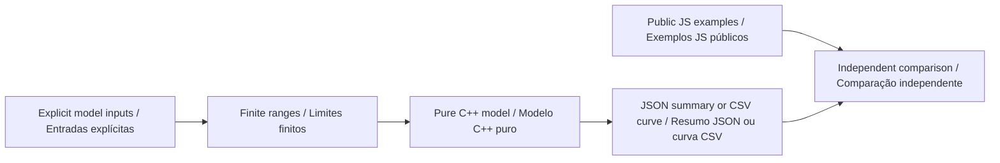

# C++ model guide · Guia do modelo C++

[English](#english) · [Português](#portugues) · [Project / Projeto](../README.md)

**C++17 · CMake 3.20+ · JavaScript parity / Comparação com JavaScript**



<a id="english"></a>

## English

The C++ implementation is a reusable numerical library with a command line. It calculates reaction distance, braking distance, a supplied margin and the inverse quadratic speed bound. It allows an independent implementation to check the browser calculations before a controlled physical study is designed.

### Build and execute

Use a C++17 compiler and CMake 3.20 or newer. GCC and Clang are exercised in Linux CI; local Windows verification used the Clang compiler distributed with Zig 0.16.0. A compiler is needed only for this offline component.

```sh
cmake -S . -B build -DCMAKE_BUILD_TYPE=Release
cmake --build build --config Release
ctest --test-dir build -C Release --output-on-failure
```

With a single-configuration generator on Linux:

```sh
./build/stop-envelope 1 250 100 1 20 0.2 2
./build/stop-envelope --curve 1 250 100 1 20 0.2 2
python cpp/tests/check_parity.py build/stop-envelope
```

With a Visual Studio generator, executables are normally under `build/Release/`; use `build/Release/stop-envelope.exe` in the commands. For the cross-language check, Python 3.11+ and Node.js 22+ must also be installed. No third-party C++ library is required.

Arguments, in order:

| Argument                     | Unit | Accepted range |
| ---------------------------- | ---- | -------------- |
| speed_mps                    | m/s  | 0 to 10        |
| reaction_ms                  | ms   | 0 to 10,000    |
| reaction_uncertainty_ms      | ms   | 0 to 10,000    |
| deceleration_mps2            | m/s² | 0.01 to 20     |
| deceleration_uncertainty_pct | %    | 0 to 95        |
| margin_m                     | m    | 0 to 20        |
| available_m                  | m    | 0 to 1,000     |

The CLI accepts decimal/scientific numeric notation and rejects partial numbers, hexadecimal notation, NaN, infinity and out-of-range inputs. Default output is JSON. `--curve` emits 41 CSV rows from 0 to 10 m/s in 0.25 m/s increments, using the remaining six assumptions. Exit status is 0 for a completed curve or a supplied distance that covers the selected modeled envelope, 2 for a distance deficit (JSON is still written), and 1 for invalid input.

### Worked result

The nominal fictional input uses 1 m/s, 250 ms reaction, 100 ms additional reaction uncertainty, 1 m/s² deceleration, 20% deceleration uncertainty, a 0.2 m margin and 2 m available distance.

```text
nominal = 1 * 0.25 + 1² / (2 * 1) + 0.2 = 0.95 m
upper = 1 * 0.35 + 1² / (2 * 0.8) + 0.2 = 1.175 m
remaining = 2 - 1.175 = 0.825 m
```

Inspect the [actual JSON output](../examples/cpp/nominal.report.json) and [41-row curve](../examples/cpp/nominal.curve.csv). JSON uses full floating-point precision; the browser rounds displayed report fields to six decimals. Parity checks use an explicit absolute tolerance of 1.1e-6 and a relative tolerance of 1e-10.

### Library interface

```cpp
#include "stop_envelope.hpp"

go2::Input input{1, 250, 100, 1, 20, 0.2, 2};
go2::Result result = go2::analyze(input);
// result.upper_m is 1.175 m under the supplied assumptions.
// result.upper_m é 1,175 m sob as premissas informadas.
```

The [header](../cpp/include/stop_envelope.hpp) exposes the pure model. The [CLI](../cpp/src/main.cpp) handles parsing and serialization. The [C++ tests](../cpp/tests/test_model.cpp) check known answers, conservation of distance components, the inverse root, zero speed, zero reaction, threshold precision, monotonic curves and rejected inputs. The [cross-language checker](../cpp/tests/check_parity.py) compares every public scenario and every curve point against the actual JavaScript engine.

### Interpretation

This constant-deceleration point model is not a physical stopping guarantee, emergency-stop implementation or robot controller. It sends no commands. Slopes, slip, actuator limits, body dynamics and measured braking behavior are outside its scope. The inverse bound is mathematical and can exceed the 10 m/s scenario input range; it is not an operating speed recommendation. Go2 PRO custom development support is not assumed; see the [study plan](GO2_PRO_PLAN.md).

<a id="portugues"></a>

## Português

A implementação C++ é uma biblioteca numérica reutilizável com linha de comando. Calcula distância de reação, frenagem, margem informada e limite de velocidade pela inversão da equação quadrática. Permite uma implementação independente para conferir os cálculos do navegador antes de desenhar um estudo físico controlado.

### Compilar e executar

Use compilador C++17 e CMake 3.20+. Os comandos acima são iguais nos dois idiomas. GCC e Clang são exercitados no CI Linux; a verificação local no Windows utilizou o compilador Clang distribuído com Zig 0.16.0. Geradores Visual Studio normalmente colocam os executáveis em `build/Release/`; use `build/Release/stop-envelope.exe`. A comparação entre linguagens também exige Python 3.11+ e Node.js 22+. Nenhuma biblioteca C++ de terceiros é necessária.

A tabela especifica os sete argumentos, suas unidades e limites: velocidade, reação, incerteza adicional de reação, desaceleração, incerteza da desaceleração, margem e distância disponível. São aceitos números decimais e notação científica; números parciais, hexadecimal, NaN, infinito e valores fora dos limites são rejeitados.

A saída padrão é JSON. `--curve` produz 41 linhas CSV, de 0 a 10 m/s com incremento de 0,25 m/s, mantendo as outras seis premissas. O código de saída é 0 para curva concluída ou distância que cobre o envoltório selecionado; 2 para déficit de distância, com JSON ainda produzido; e 1 para entrada inválida.

### Exemplo explicado

O exemplo nominal fictício usa 1 m/s, reação de 250 ms, incerteza adicional de 100 ms, desaceleração de 1 m/s², incerteza de 20%, margem de 0,2 m e distância disponível de 2 m. O resultado é 0,95 m nominal, 1,175 m superior e 0,825 m de distância restante. Consulte o [JSON executado](../examples/cpp/nominal.report.json) e a [curva de 41 linhas](../examples/cpp/nominal.curve.csv).

O JSON preserva a precisão de ponto flutuante; o navegador arredonda os campos de apresentação para seis casas decimais. A comparação usa tolerância absoluta de 1,1e-6 e relativa de 1e-10. O exemplo de biblioteca acima chama o mesmo cálculo real da linha de comando.

### Validação e limites

Os testes verificam respostas conhecidas, soma das componentes, raiz inversa, velocidade zero, reação zero, precisão dos limiares, monotonicidade e rejeição de entradas. A comparação executa o motor JavaScript real para todos os cenários públicos e pontos das curvas.

Este modelo pontual de desaceleração constante não garante parada física, não implementa parada de emergência e não controla robôs. Não envia comandos. Inclinação, escorregamento, limites de atuadores, dinâmica corporal e frenagem medida ficam fora do escopo. O limite inverso é matemático e pode superar a faixa de entrada de 10 m/s; não é recomendação de velocidade operacional. Suporte a desenvolvimento personalizado no Go2 PRO não é presumido; consulte o [plano de estudo](GO2_PRO_PLAN.md).
